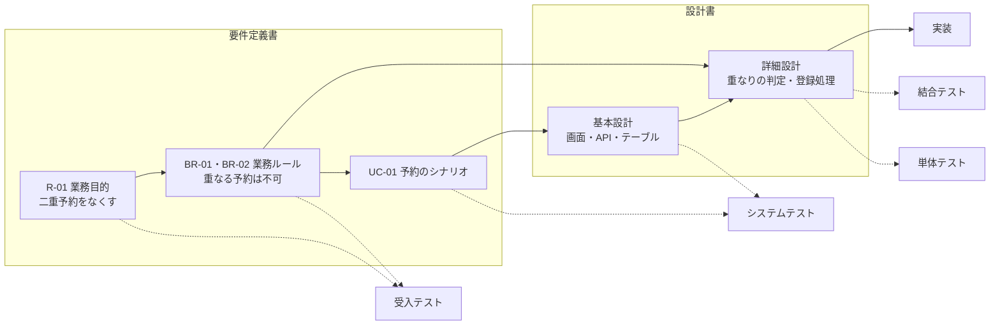

# 全体のつながり：1つの要件を、設計・実装・テストまで追う

- 状態：調査中（最後の「理解の確認」がまだです）
- 完了条件：
    1. 1つの要件について、要件定義書・設計書・実装・テストの実例がそろい、つながりが示されている
    2. つながりの各段について、資料のどこに基づくか、または AI の提案かが書かれている
    3. AI の確認の質問に、依頼者本人が答えられている

情報源のID（S06 など）は [情報源台帳](../../sources.md) を見てください。

## つまり何か

- 成果物は、次の成果物を作るための材料です。同時に、テストで「何を確かめるか」を決める材料でもあります。
- 要件定義書に書いたことは、設計書・コード・テスト項目に形を変えて現れます。
- 書かなかったことは、後の誰かが黙って決めるか、誰も確かめないまま残ります。

## 実例でたどる

題材は、架空の「会議室予約システム」です。次の要件を1つだけ追います。

> 同じ会議室の同じ時間帯に、二重に予約できない。

実例の全文はこちらです。

- [要件定義書（抜粋）](examples/meeting-room/requirements.md)
- [設計書（抜粋）](examples/meeting-room/design.md)
- [実装とテストコード](examples/meeting-room/implementation.md)
- [テスト仕様書（抜粋）](examples/meeting-room/test-spec.md)

### 全体の図

- 実線の矢印：つくる流れ（左の成果物を元に、右の成果物を作る）
- 点線の矢印：テストの入力（その成果物を元に、テスト項目を作る）



図が表示されない場合は、下の ①〜④ に同じ内容を文章で書いています。

### ① 要件定義書：何を書いたか

- **R-01（業務目的）**：会議室の二重予約をなくす。
- **BR-01（業務ルール）**：同じ会議室で、時間帯が重なる予約は登録できない。
- **BR-02（業務ルール）**：終了時刻と、別の予約の開始時刻が同じなら、重なりとみなさない。
- **UC-01（システム化要求仕様）**：予約するときの、利用者とシステムのやり取り。
    - 例外シナリオ1：重なる予約があれば、知らせて、登録しない。利用者は入力を変えてやり直せる。

### ② 設計書：要件のどこから、何が書けたか

- UC-01 の入力データ（会議室、開始日時、終了日時）があるから、**画面の入力項目**（SCR-01）と**テーブルの項目**（TBL-01）が書けた。
- UC-01 の例外シナリオ1 があるから、**表示するメッセージ**（MSG-01）と、**API が返す結果**（`409`）が書けた。
- 「入力を変えてやり直せる」とあるから、**メッセージの後も入力を画面に残す**、と決められた。
- BR-01 と BR-02 があるから、**重なりの判定条件**（DD-01）が書けた。
    - BR-02 があるから、条件に等号を含めない（`<` を使い、`<=` を使わない）と決められた。

### ③ 実装：設計のどこから、何が書けたか

DD-01 の判定条件は、そのまま1行のコードになりました。

```python
def overlaps(a_start, a_end, b_start, b_end) -> bool:
    return a_start < b_end and b_start < a_end
```

DD-02 の手順1〜5 は、`reserve()` の中に、同じ順番で並んでいます。

### ④ テスト：どの成果物から、どのテスト項目が書けたか

- **単体テスト**（部品1つを確かめる）← 入力：詳細設計 DD-01
    - UT-02：10:00〜11:00 と 11:00〜12:00 は「重ならない」
- **結合テスト**（部品をつないで確かめる）← 入力：詳細設計 DD-02
    - IT-01：重なる予約はエラーになり、予約は増えない
- **システムテスト**（システム全体を確かめる）← 入力：要件定義書 UC-01、基本設計 SCR-01
    - ST-02：重なる時間帯で「予約する」を押すと、MSG-01 が出て、登録されない
- **受入テスト**（使う側が、業務で使えるかを確かめる）← 入力：要件定義書 R-01、BR-01、BR-02
    - UAT-02：前の会議が 11:00 に終わる部屋を、11:00 から予約できる

テスト項目の「期待結果」は、どれも入力にした成果物に書いてあることです。書いてなければ、期待結果は書けません。

## 書いていないと、どこで困るか

この節は、実例から AI が考えたことです（【推論】）。

### BR-02（終了=開始は重ならない）がなかった場合

- 設計者は、`<` にするか `<=` にするかを、自分で決めることになります。
- 単体テストは、設計書を入力に作ります。設計者が `<=` と決めれば、テストも「11:00〜12:00 は重なる」が正解になり、**成功します**。
- 問題が見つかるのは、使う側が受入テストで「続けて予約できない」と気づいたときです。気づかなければ、そのまま本番に出ます。

実際に、実装の `<` を `<=` に変えて試しました。BR-02 を元に作ったテスト（UT-02、IT-03）だけが失敗しました。つまり、この2つは BR-02 が書かれていなければ、存在しなかったテストです。

### 例外シナリオ（重なったときどうするか）がなかった場合

- メッセージの文言も、入力を残すかどうかも、設計者任せになります。
- システムテスト ST-02 の期待結果が書けません。「何かエラーが出る」としか書けなくなります。

### この実例でも、書いていないこと

- 2人が、ほぼ同時に同じ時間帯を予約した場合の扱いは、要件定義書で未決のままです。
- そのため、設計書でも扱っておらず、テスト項目もありません。この実例の中で、つながりが切れている場所です。

## 何のために必要か

- 成果物の良し悪しを、「次の人が使えるか」で判断できるようにするためです。
- 「項目がそろっているか」だけを見ても、上の BR-02 のような抜けには気づけません。

## どんなときに使うか

- 要件定義書や設計書をレビューするとき
- AI が作った成果物を確かめるとき
- 既存の設計書やコードから、要件を組み立て直すとき（矢印を逆向きにたどります）

## 何を確認すれば判断できるか

成果物の記述1つずつについて、次の3つを確かめます。これは AI の提案です。

1. この記述から、次の成果物のどこが書けるか。次の人が、自分で決めずに済むか。
2. この記述から、テストの期待結果が書けるか。
3. 逆向きにたどれるか。テスト項目やコードから、元の記述を1つに特定できるか。

## なぜそう言えるか

要件定義書が、設計・実装・テストにつながること：

- 【出典】IPA のガイドは、要件定義ドキュメントを「後続する設計、実装、テスト工程につなぐ」ものとしている（S06、3.3 節、本文確認）。
- 【出典】同じガイドは、基本設計を、要件定義で合意した要件を詳細化する工程と説明している（S06、3.1 節、本文確認）。
- 【出典】業務ルールは「業務処理定義」に、利用者とシステムのやり取りは「システム化要求仕様」に書く。後者は基本・代替・例外のシナリオを考える、とされている（S06、7.5.5 項・7.9.1 項、本文確認）。

成果物が、テストの入力になること：

- 【出典】JSTQB のシラバスは、テストで「何をテストするか」を決める作業を、「テストベース」を分析することだと説明している（S13、1.4 節、本文確認）。テストベースとは、テストを作るときの元にする資料のことです。
- 【出典】旧版のシラバスは、テスト工程ごとに、テストベースにできる成果物の例を挙げている（S14、2.2 節、本文確認）。
    - コンポーネントテスト（単体テスト）：詳細設計、コード など
    - 統合テスト：ソフトウェア設計とシステム設計、インターフェースの仕様 など
    - システムテスト：システム要求仕様およびソフトウェア要求仕様 など
    - 受け入れテスト：ビジネスプロセス、ユーザー要件またはビジネス要件 など
- 【出典】テストケースと要件を対応づけておくと、要件がテストで確かめられていることを検証できる、とされている（S13、1.4.4 項、本文確認）。

早い段階でテストを考える効果：

- 【出典】IPA のガイドは、要件定義や基本設計の段階でテスト仕様を固める方法を「W モデル」と呼んでいる。総合テスト計画書を作ることで見つかる要求の漏れは多い、とも書いている（S06、7.13.3 項、本文確認）。

AI が考えたこと：

- 【推論】日本でよく使う「結合テスト」「総合テスト」は、JSTQB の「統合テスト」「システムテスト」にほぼ当たると考えた。「単体テスト」は、JSTQB が「コンポーネントテスト（ユニットテストとも呼ばれる）」と書いている。
- 【提案】実例の ID の付け方、設計書の分け方、「確認する3つのこと」は AI が作ったもの。

主張の区分：

- 「成果物は、後の工程とテストの入力になる」：広く認められている原則。公的機関のガイドと、資格団体のシラバスの両方に書かれている。
- 「早い段階でテストを考えると、漏れや手戻りが減る」：根拠が十分かは未確認。IPA のガイドに書かれているが、効果を確かめたデータは見ていない。

## 確認できたこと・できなかったこと

確認できたこと：

- 実装と、単体テスト・結合テストは実際に動かした（8件すべて成功）。
- 境界の決まりを変えると、BR-02 を元にしたテストだけが失敗した。

確認できなかったこと：

- システムテストと受入テストは仕様だけで、実行していない（画面と API を実装していないため）。
- 追ったのは要件1つだけ。要件が多いとき、つながりをどう保つかは扱っていない。
- 設計書の「よくある形」は、公開サンプルでまだ裏付けていない。この実例の設計書は AI が作った形。
- テスト工程ごとの入力の例は、旧版（2018年版）のシラバスに載っている。現行版（V4.0）の同じ節には載っていない。理由は確認していない。
- IPA のガイドは、テストの工程名に「総合テスト」を使う。JSTQB の用語との対応は AI の推論で、対応を明記した資料は見ていない。

## 理解の確認

AI が質問し、本人が答えます。答えは、そのまま記録します。

1. 要件定義書に BR-02（終了=開始は重ならない）が書かれていなかったとします。単体テストは成功しますか、失敗しますか。それはなぜですか。
    - 答え：（未回答）
2. 受入テストの項目 UAT-02 は、どの成果物の、どの記述を入力にして作られていますか。
    - 答え：（未回答）
3. この実例で、要件定義書に書かれていないために、設計書にもテストにも現れていないことは何ですか。
    - 答え：（未回答）
